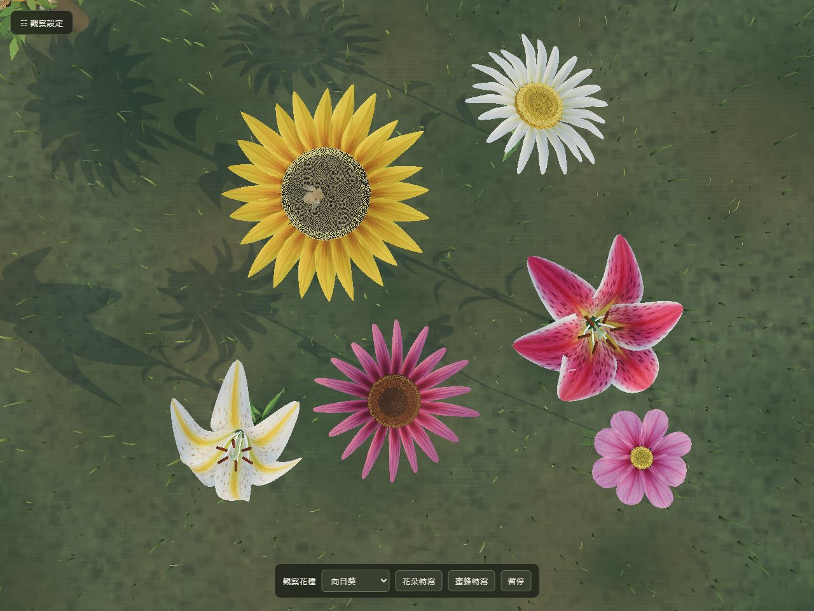
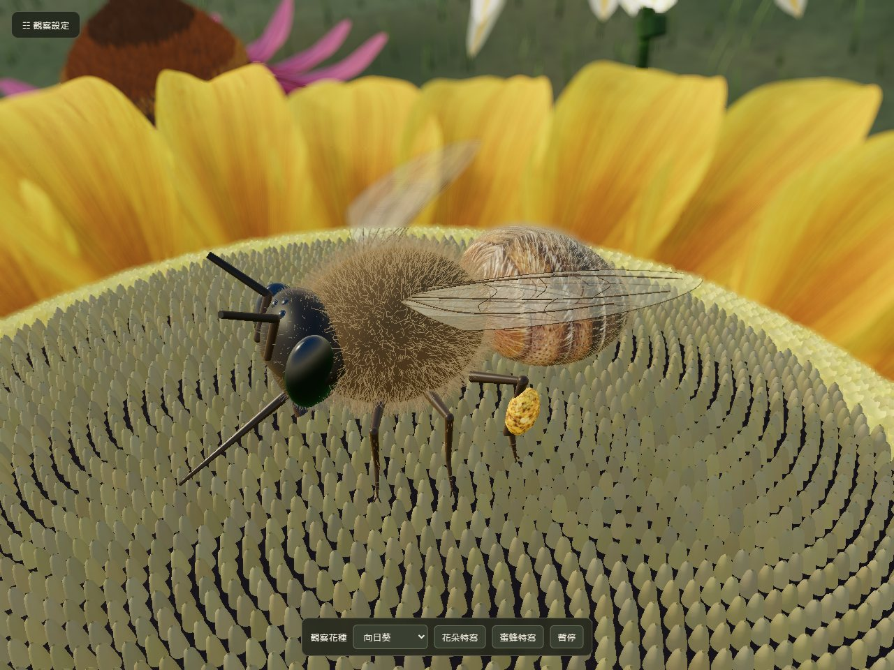
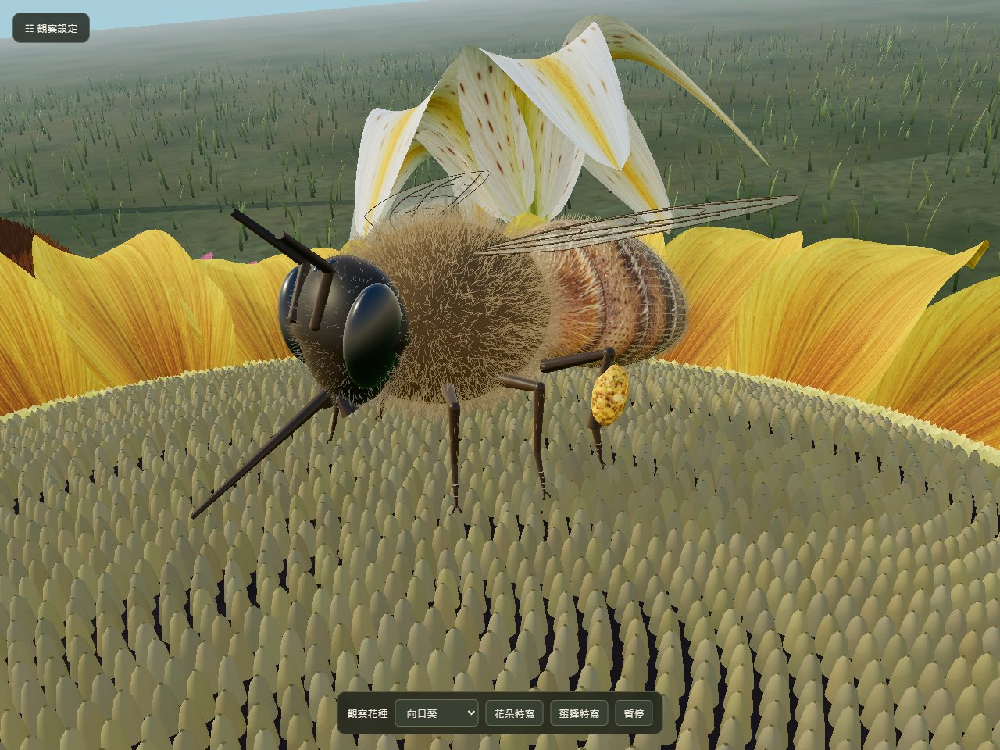
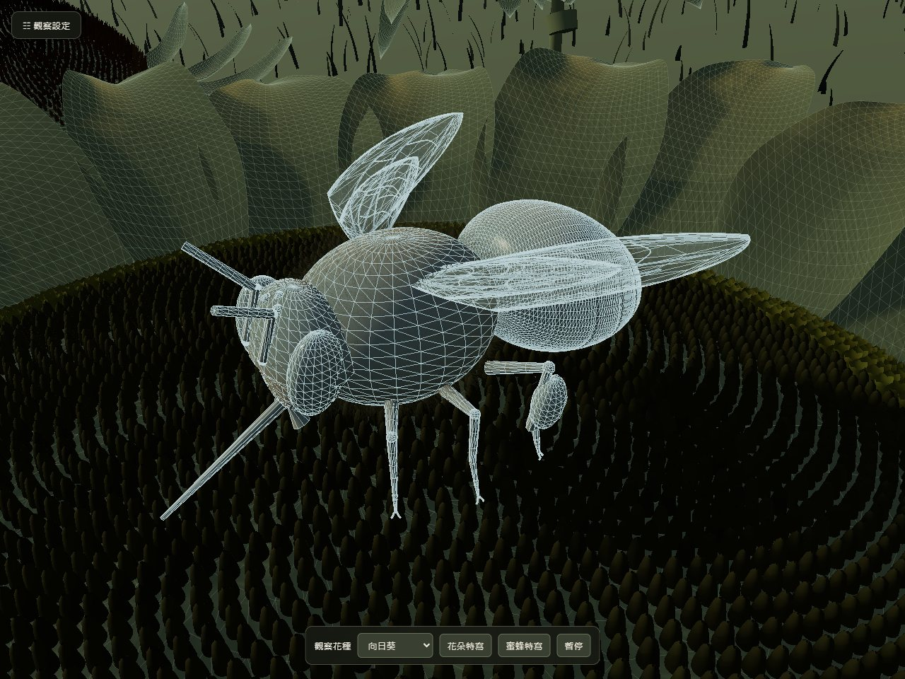

# Realistic Bee & Flowers

**English** · [繁體中文](README.zh-TW.md)

**Live demo**: <https://malilion.github.io/bee_scene/>



## Overview

An interactive 3D scene that runs in the browser: a western honeybee (*Apis mellifera*) forages among six kinds of flowers in a meadow, flies back to the hive, performs the waggle dance and stores nectar in the comb. Everything is modeled procedurally with Three.js (WebGL) and textured with AI-generated realistic material atlases, with a day-light cycle, macro depth of field and several observation cameras.

It is a realistic-style interactive piece, not photography and not a rigorous biological simulation.

## Quick start

**Open directly**: open **`index.html`** in Chrome or Edge. It is a single offline file with Three.js and all textures embedded. No install, network or server needed.

**With a static server**: `bee_scene.html` is the editable module source. It loads `vendor/` and `assets/` through an import map, and browsers block module loading from `file://`, so serve the folder over HTTP:

```bash
# from the project root, either one
python -m http.server 8765
npx serve -l 8765 .
```

Then open <http://localhost:8765/bee_scene.html> (or `/index.html`).

## Screenshots

| Bee macro close-up | Low angle, leg contact |
|---|---|
|  |  |
| **Wireframe** | **Top view** |
|  |  |

## Controls

**Bottom toolbar**

| Control | What it does |
|---|---|
| Flower picker (觀察花種) | Choose one of six flowers: sunflower, purple coneflower, Stargazer lily, oxeye daisy, golden-rayed lily, pink cosmos |
| Flower close-up (花朵特寫) | Switch to the orbit camera, frame the flower to fit the screen and enable depth of field |
| Bee close-up (蜜蜂特寫) | Switch to the macro camera and send the bee to the selected flower, keeping it in focus |
| Pause / Resume (暫停／繼續) | Stop or resume all behavior animation |

**"☷ 觀察設定" (Observation settings) panel, top left**

| Section | Controls |
|---|---|
| Daylight timeline | Drag 06:00–18:00 to change sun direction, light color and exposure; auto time; soft bloom |
| Behavior stages | Jump to Morning sortie / Foraging / Waggle dance; auto cycle |
| Status | Pollen basket load (0–3), stored honey cells (0–12), harvest count |
| Camera | Free orbit, Macro, Chase cam, Bee POV (first person) |
| Speed & paths | Flight and action speed 0.2×–2.5×; show the 3D flight / waggle-dance path |

**Mouse**

- Free orbit mode: left-drag to rotate, right-drag to pan, wheel to zoom (down to the florets).
- Hover a flower to see its name and remaining nectar; **click a flower** to send the bee there.
- **Click the hive** to send the bee home to dance.

## How it plays

It is an observation sim with no win or lose state. The bee runs its own daily loop, and you can step in at any time:

1. **Morning sortie**: the bee leaves the hive and patrols the flower patch along a smooth 3D curve.
2. **Foraging**: it picks a flower with plenty of nectar, lands and stands on the flower head with all six legs. Each flower's nectar drains while it feeds and slowly refills afterwards, so the bee rotates between flowers.
3. **Return**: once the pollen baskets hold 3 loads it flies back to the hive.
4. **Waggle dance**: it dances on the comb to signal the flower's location while filling honey cells one by one.
5. **Harvest**: when all 12 cells are full, a harvest fires, the comb empties, the harvest count goes up and the bee sets out again.

Things to try: click flowers to choose where the bee goes, turn off auto cycle and advance each stage yourself, drag the timeline from dawn to dusk, or ride along in first person.

## Built with

- **Three.js 0.160.0** (WebGL). The flowers, bee and hive are all modeled procedurally in code.
- PBR materials, a day-light cycle, soft shadows, optional bloom and macro depth of field.

## Project structure

```
.
├── index.html          # Single-file offline build (open directly)
├── bee_scene.html      # Editable module source (needs an HTTP server)
├── assets/             # Texture atlases, texture-data.js, generation prompts
├── vendor/three/       # Three.js 0.160.0 and the add-ons used (MIT)
└── docs/screenshots/   # README screenshots
```

**Rebuilding `index.html`**: after editing `bee_scene.html` or `assets/`, regenerate the offline file with `./build-scene.ps1 -BundleOnly` (Windows), or `node .buildtools/bundle-scene.cjs` with esbuild on `PATH` (or set `ESBUILD_BINARY`).

## License and sources

Three.js is MIT-licensed (see `vendor/three/LICENSE`). The texture atlases are AI-generated realistic references, not biological scans; the prompts are in [assets/IMAGE_PROMPTS.md](assets/IMAGE_PROMPTS.md).
